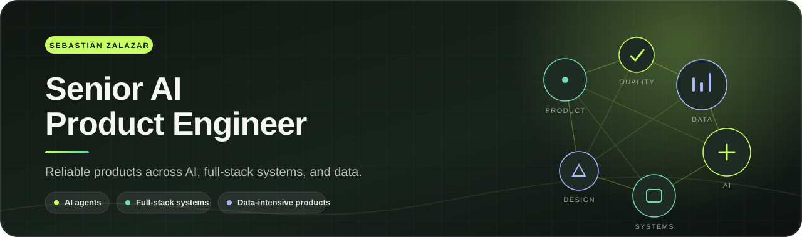
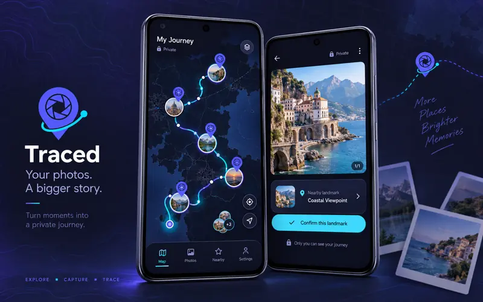
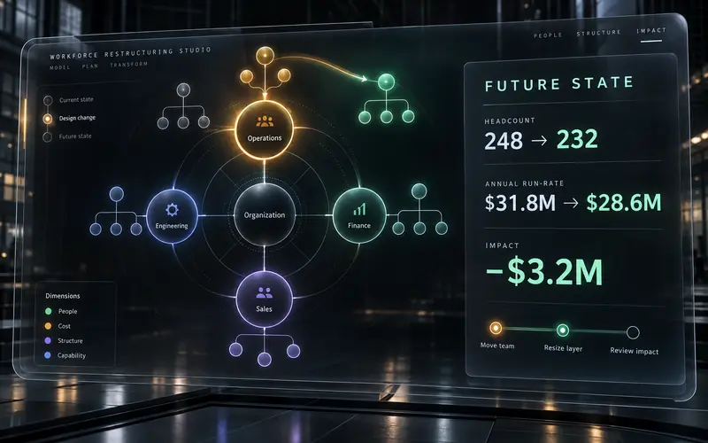
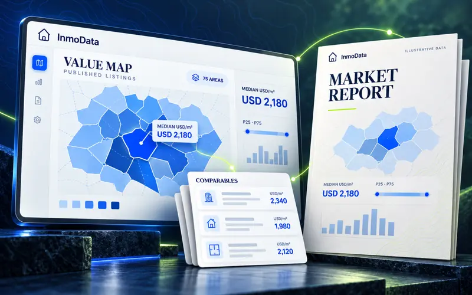
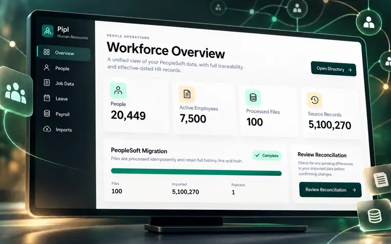
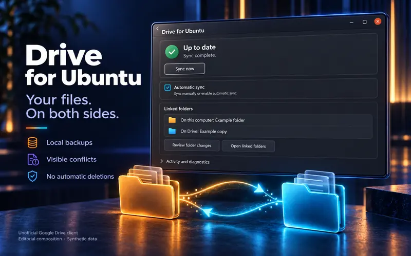
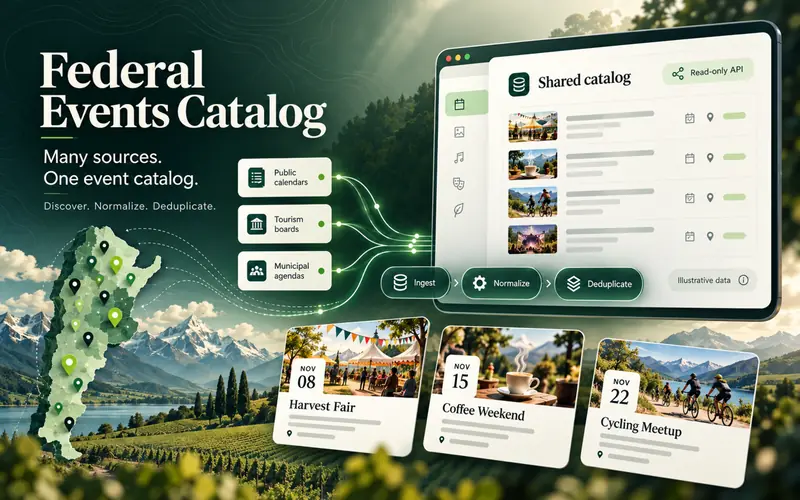

  

  <strong>Buenos Aires, Argentina</strong>
  &nbsp;·&nbsp;
  <a href="https://www.linkedin.com/in/szalazar/">LinkedIn</a>

I build reliable AI products end to end across backend, frontend, data, and product. My work draws on years of systems engineering and focuses on making complex workflows clear, traceable, and useful—from private SaaS platforms to mobile and desktop applications.

## Selected product work

<table>
  <tr>
    <td width="50%" valign="top">
      
        
      <strong>Traced</strong> 
      Turns geotagged photos into a private travel map and suggests nearby places from a self-hosted OpenStreetMap catalog.  
      EXPO · REACT NATIVE · TYPESCRIPT · POSTGIS · MINIO
    </td>
    <td width="50%" valign="top">
      
        
      <strong>Workforce Restructuring Studio</strong> 
      Models organizational change through reversible scenarios, radial structures, financial impact, and a bounded local assistant.  
      REACT · TYPESCRIPT · D3.JS · FASTAPI · LOCAL LLM
    </td>
  </tr>
  <tr>
    <td width="50%" valign="top">
      
        
      <strong>InmoData</strong> 
      Transforms published property listings into comparables, regional context, and client-ready reports for better pricing conversations.  
      LARAVEL · LIVEWIRE · POSTGRESQL · POSTGIS · PYTHON
    </td>
    <td width="50%" valign="top">
      
        
      <strong>Pipl</strong> 
      Modernizes effective-dated HR data while preserving history, source provenance, permissions, and operational traceability.  
      LARAVEL · REACT · TYPESCRIPT · POSTGRESQL · DOCKER
    </td>
  </tr>
  <tr>
    <td width="50%" valign="top">
      
        
      <strong>Drive for Ubuntu</strong> 
      Provides desktop file synchronization with visible conflicts, resilient transfers, and clear recovery from interruptions.  
      UBUNTU DESKTOP · RESILIENT SYNC · LOCAL-FIRST UX
    </td>
    <td width="50%" valign="top">
      
        
      <strong>Federal Events Catalog</strong> 
      Normalizes tourism and cultural events from many public sources into a reusable API and operational dashboard.  
      LARAVEL · VUE · TYPESCRIPT · POSTGRESQL · POSTGIS
    </td>
  </tr>
</table>

Product visuals use synthetic or aggregated data. Source code, infrastructure, credentials, and private operational data are not published.

## Engineering focus

**AI engineering** — AI agents, domain-scoped assistants, local and hosted LLM integrations, tool-driven workflows, and human-in-the-loop systems.

**Product systems** — Full-stack architecture, data modeling, APIs, multi-tenant platforms, privacy, traceability, and resilient operational workflows.

**Core technologies** — Laravel, Vue, React, TypeScript, PostgreSQL, Python, and Docker.

## Let’s connect

If my work feels relevant, [LinkedIn](https://www.linkedin.com/in/szalazar/) is the best place to reach me.
